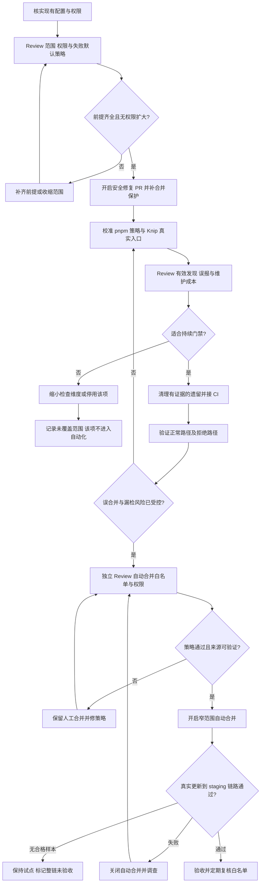
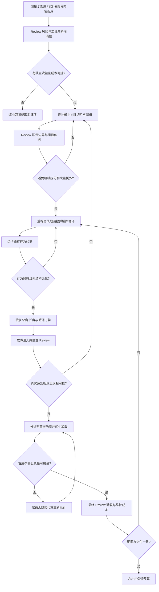
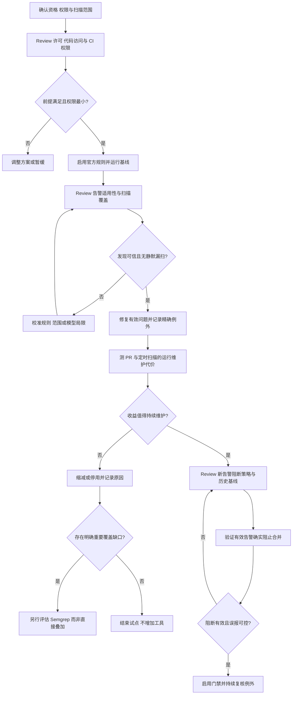

# 程序性质量与依赖安全补足计划

日期：2026-10-27。类型：实施计划（执行顺序与验收），不是当前已启用能力的参考文档。

目标：补齐持续自动运行的代码质量和依赖安全机制，减少日常人工维护；不以工具数量、测试数量或报告数量作为成果。本文归纳三批行动及后续安全更新自动合并策略。写入计划不等于已执行，也不授权修改生产发布边界。

## 起点与边界

- 已合并的 [PR #34](https://github.com/The-poem-of-destiny/workshop/pull/34) 提供：零警告 Biome、工作区检查覆盖、客户端类型检查、简单导入边界、全产物 gzip 预算、Gitleaks CI，以及 [测试维护准则](../../.agents/skills/test-maintenance/SKILL.md)。这些是前置基础，不重复实施。
- 2026-10-27 查询结果：Dependabot 普通 npm／Actions 周更配置存在，最近查询到的任务成功；安全修复 PR 当时关闭。服务端必需检查、CodeQL、自动合并仍需实施时重新核实，不能依赖本次快照。
- 不新增截图基准、测试平台或测试数量／覆盖率目标。实现验证复用已有检查；新增永久测试按上述 skill 准入，工具接线优先临时故障注入。
- 不引入第二个依赖更新机器人；不同时部署 CodeQL 与 Semgrep；不默认自动 production 发布。个人 `.env` 与个人 Cloudflare token 不进入机器人或 CI。
- 三批按依赖顺序推进，各批内按关注点拆独立 PR；配置、死代码清理和结构重构不得混成一个难审查的大 PR。每个 PR 明确收益、首次整改成本、长期维护成本与退出方式。
- 工具按**相对现有工具的边际收益**选择：先列出 TypeScript／Biome／Knip／现有构建和 CI 已能覆盖的风险，再说明新增机制独有的实际保障，与新增依赖、解析器、配置、运行、误报和升级成本比较。具有某项能力不等于值得引入；默认候选包括“不新增工具”，已安装和已投入的工作不构成保留理由。未能证明净增量价值时移除试点，不用总收益代替边际收益。

## 第一批：补齐已有体系，完成依赖安全与代码卫生

### 行动顺序

### 交付与取舍

| 工作 | 交付 | 收益与成本控制 |
|---|---|---|
| Dependabot 安全更新 | 核实依赖图／告警前提，开启安全修复 PR；保留现有普通周更，核对分组和数量上限 | 优先补已有机器人，不重复部署 Renovate；无修复版本或约束冲突不保证能生成 PR |
| 合并保护 | 核实实际 ruleset／branch protection，使 `check`、`e2e`、`secrets` 成为强制检查；防止机器人绕过 | CI 运行与服务端强制是两回事；不要为了机器人自动批准而取消所有人的保护 |
| pnpm 供应链配置 | 查明冷静期实际值、现有例外、`allowBuilds` 与冻结 lockfile；收敛不必要例外 | 冷静期降低新版本风险，但安全修复可能需有理由地例外；不永久放开所有安装脚本 |
| Knip | 按真实 package exports、Worker、CLI、自定义 esbuild 与测试入口配置；先验证依赖维度，再决定文件／导出维度 | 不自动删除。每个有效发现核实消费者；误报不得靠整目录排除消音。先证明持续检查值得维护，再进入权威命令 |
| 安全更新自动合并 | 单独的最小权限策略工作流，初期仅允许明确白名单的安全 patch 更新；其他人工处理 | 目标是减少日常点击，不是所有安全更新无条件放行；配置本身也要可审查、可关闭 |

### 自动合并必须满足的条件

1. 可靠核验 Dependabot PR 的作者、来源和机器元数据，并核实确实涉及已知漏洞修复；不只信标题或标签。若拿不到可靠的安全更新判定，默认不自动合并。
2. 更新依赖全部在允许范围，分组内不能只检查一个依赖；仅 manifest／lockfile 等明确允许文件变化。major、Actions、权限／安装脚本／registry 变化及策略不认识的情况转人工。
3. 最新待合并 head 的必需检查通过；分支保护有效且机器人无管理员绕过能力。2026-10-27 用户批准：已 CLEAN 时使用带 expectedHeadOid 的普通服务端受保护合并，不留下延迟授权；不要求机器人完整审计其他所有 actor。远端 strict、管理员强制、App 绑定、禁 force/delete 基线维持不变，部分配置漂移由 owner 审计，不冒充运行时全量可见。
4. 合并控制任务不执行不可信 PR 代码，不向 PR 检查暴露部署凭据。需要额外身份时优先最小权限 GitHub App，不使用个人长期 token。
5. 核实所选 token／事件确实触发 main CI 和 staging，不假定 `GITHUB_TOKEN` 引发的所有事件都会递归触发工作流。不能通过悄悄换高权限 token 来补救。
6. 初期仅通向 staging；production 继续遵循已有 tag／审批边界。staging 检查失败不继续推广，保留精确版本与回退目标；代码回退不等于数据迁移回滚。

### 完成标准

- 有当前远端设置证据，安全修复已启用；未遇新漏洞时不伪造一个“真实安全 PR”作为成功证据。
- 用可控的临时策略输入证明不合格作者、分组夹带、major、越界文件、缺检查等会拒绝；真实合格更新可在出现时补齐整链验收。在此之前明确记录未实证部分，不宣称全链完成。
- Knip 在本地与 CI 可重现，真实入口未漏扫；有效遗留已处理，保留例外逐项有依据，命令对违规返回非零。
- 自动合并有总开关；不能确认来源或策略时保持人工，不自动批准模糊更新。

## 第二批：治理结构与资源负担，再建立规模约束

### 行动顺序

### 交付与取舍

| 工作 | 交付 | 收益与成本控制 |
|---|---|---|
| 复杂度／函数长度 | 使用现有 Biome 能力测基线，治理最危险函数，给出有依据的阈值 | 不先定一个会逼出大量包装函数的数字；不能提高到当前最大值再宣称治理完成 |
| 文件行数 | 区分生产代码、测试等用途，设置辅助上限 | 只作防膨胀约束，不以小文件证明良好设计；避免散落特例 |
| 循环依赖 | 选一个能准确解析本 workspace、别名和类型导入的图工具，修复真实循环后接 CI | Biome 路径限制不是完整图分析。只有证明增量能力后才新增依赖，不同时引入多个图工具 |
| 包体积治理 | 分析依赖组成，对管理／编辑等非首屏功能评估延迟加载；继续守全 JS／CSS gzip 预算 | 延迟加载改善首屏，不一定降低总量；必要时增加准确的入口指标，不用分 chunk 隐藏字节 |
| 额外 TS 选项 | 仅对发现的具体风险试点，证明收益后启用 | 不整批开开关，不用断言／`!` 把报错压回去；没有独立收益可以不加入 |

### 完成标准

- 阈值、适用范围和例外都有依据；现有违规已真实治理，未增加无意义抽象、忽略目录或批量 suppress。
- 循环工具对真实有效导入准确解析，临时注入循环会失败；与已有路径边界各自负责不同风险。
- 体积优化有相同构建条件下的初始资源／全产物对比，不能仅凭 Vite 不再提示就宣布性能改善。
- 重构通过现有类型、检查与相关运行旅程；不为每个拆分后的私有函数新增永久测试。

## 第三批：CodeQL 安全分析试点与持续处置

**2026-10-27 决策：用户明确“不引入 CodeQL”。本批以不采用结论关闭，不实施下面保留的原试点流程和扫描验收项，也不自动引入 Semgrep 替代。未运行扫描、未建立 code-scanning 告警门禁；不将未扫描称作零告警。**

现有 TypeScript／Biome／Knip／Gitleaks／Dependabot 各守原职责，不等价于跨函数安全污点分析或 Actions 信任边界扫描。此次不增加该覆盖，避免新增运行、告警研判、升级与许可维护负担；未来只有具体重要风险与明确边际收益支持时，再由 owner 决定是否重开评估，不自动启用。

### 行动顺序

### 交付与取舍

- 优先 CodeQL 官方维护的 JavaScript／TypeScript 安全规则，单独并行 job，不塞入每次本地 `pnpm check`；同时评估 Actions 工作流扫描的增量收益。
- 初期不用自定义查询或付费平台。先测实际运行时长、有效发现、重复／误报数量与处置负担，不预先承诺扫描速度或“零维护”。
- PR 扫描防止引入新问题；定期默认分支扫描发现规则／漏洞知识变化带来的新风险。普通依赖漏洞继续由 Dependabot 负责，避免重复处置。
- 扫描任务成功不等于发现已被阻断。若接合并门禁，明确 code-scanning 保护规则、严重度／精确性与历史基线处理方式，并验证新增有效告警确实阻止合并。
- 不凭 CVSS 或工具等级自动改业务代码；确认适用性后处理。例外包含原因、范围和复查条件，不整类永久静音。
- Semgrep 暂不并行常驻。只有出现具体、重要且 CodeQL 无法低成本覆盖的缺口时，验证 CE 或平台的可用能力、许可、代码访问与维护成本，再决定补充或替换。免费额度不等于全功能免费或无需维护。

### 完成标准

- 使用官方文档核实当前资格与权限；不把公开仓库免费使用理解为无资源限制。
- 有一次真实全量扫描和后续触发证据，记录耗时与发现分类；有效问题已处理或有具体风险处置，不用“零告警”代替有效性判断。
- PR 与定时触发范围明确；若阻断合并，必须有可控验证，不仅证明 job 运行。
- 有可执行的保留／停用结论和例外复查责任，不因已经接入就无限承担低收益噪声。

## 执行拆分与停止条件

建议 PR 单位：安全更新与服务端保护、Knip 及清理、窄范围自动合并、结构门禁与必要治理、体积优化、CodeQL 试点。按实际依赖调整先后，但不将这些合成一个混杂 PR。

每个 PR 合并前检查：能自动判断什么、实际拒绝过什么、有效范围是什么、增加多少配置与运行负担；同时报告未实证的线上／宿主边界。未知不冒充完成，无法验证的自动合并保持关闭。新增机制若主要产出需人工解释的报告、没有可信独立收益，缩减或取消，而不是继续堆工具。

## 执行记录

### 第一批（2026-10-27，进行中）

- 独立工作树 `../workshop-hardening` 基于 `origin/main` `eeb7f09`，不包含原工作树未提交的产品改动。
- 远端：Dependabot 安全修复已启用；`main` 必需 `check`／`e2e`／`secrets`，绑定 Actions app `15368`、strict、管理员也受保护，不允许 force push／delete。Actions 默认令牌只读且禁止机器人审批。
- Knip 6.43.0 依赖维度已实际通过，零发现／零配置提示；临时注入 `unused-gate-smoke-fixture` 后退出 1，删除后恢复通过。CSS 消费者真实入图；Cloudflare 宿主模块及跨 workspace 命令有精确说明。未发现可删除的依赖。
- 文件／导出人工审计报 2 个文件、29 个导出、20 个导出类型，尚未逐个核实；不将这份报告冒充已治理，也未接该维度持续门禁。后续清理应独立关注点。
- 冷静期显式 1440 分钟；三个 Cloudflare 例外均于 2026-10-20 发布，已过期并移除。`allowBuilds` 只保留 esbuild／workerd；Node 最低 22.12.0 与 Knip 要求一致。
- [PR #35](https://github.com/The-poem-of-destiny/workshop/pull/35)（依赖卫生）与 [PR #36](https://github.com/The-poem-of-destiny/workshop/pull/36)（安全策略）分别通过 check／e2e／secrets 并合并。安全策略六组永久边界测试通过；真实 runner 临时故障注入 6/6，通过首次／轮询读取失败撤权、关闭开关跨页回收、独立恢复、撤权失败红灯、合并竞态精确 dispatch。独立安全复审 `findings: []`。
- 初次 [run 40467982092](https://github.com/The-poem-of-destiny/workshop/actions/runs/40467982092) 确实在 `branchProtectionRule` 被拒，但“必须新增 App”结论过强：完整配置读取是实现增加的前提，不是普通受保护合并必需。后续真实内置令牌探测读到非管理员 `refUpdateRule`、公开检查/App 元数据和漏洞关联查询；仍无真实合格漏洞样本，不伪造安全更新→staging 全链。
- 第二批预调查：Biome 默认阈值（复杂度 15／函数 50／文件 300）产生 203 项信息诊断，包含 React JSX 与测试套件。不能直接升级为阻断；需按职责治理与分类阈值，不以默认数字逼出包装函数。
- [PR #37](https://github.com/The-poem-of-destiny/workshop/pull/37) 合并关闭状态清理模式；真实 [run 40469653122](https://github.com/The-poem-of-destiny/workshop/actions/runs/40469653122) 成功并明确输出 `mode=cleanup-only`／`automerge=disabled`／`qualification=BLOCKED`。这只证明清理模式，不代表权限资格恢复。
- 扩大调查后，用户批准保护执行与全局配置审计分层：不迁移/弱化保护，不新增身份；运行时核验可读门禁、本机器人 `viewerCanMergeAsAdmin: false` 和精确 PR 资格，保留全部内容／漏洞来源校验。写权限 [run 40487964827](https://github.com/The-poem-of-destiny/workshop/actions/runs/40487964827) 证明 `viewerCanPush: true` 不等于管理员 bypass，非管理员规则和 alerts 均可读。修正 CLEAN→auto-merge API 的不匹配，改普通 expected-head 服务端合并；新实现尚待故障注入、独立 review 与正式 main workflow 验收，总开关暂保持关闭。
- 修正版九组永久行为测试通过，真实 runner 的临时 fetch-boundary 注入 13 场景通过：合格输入精确 head squash→确认→精确 CI dispatch、CLEAN／bypass／metadata／ruleset／head/base 漂移拒绝、响应丢失后确认接续、未合并不 dispatch、关闭清理和独立恢复。它们不是 GitHub 真实漏洞资格验收。未向绝不能合并的临时调查 PR 发 merge 请求，避免保护若失效时把探针合入 main。

### 第二批（2026-10-27，已合并）

- 职责治理覆盖 checker 来源／AST／能力规则、ContentService 模式与 claim、作者／管理存储域、安装世界书／Regex／registry、迁移实体／资产／验证，以及前端 shell／工作区／详情。
- 阻断范围：手写生产非 JSX 与非测试 tools 为认知复杂度 40、函数 120、文件 600；TSX 为 60／300／700，行数跳过空行。测试（含 E2E）不按生产函数标准约束。六项阈值均用边界值通过／超限拒绝故障注入验真；15 个非测试 tools 在相同阈值下通过，无需额外整改。CSS 700 的试点会要求仅为行数拆散三个界面样式域，未证明净收益，故不采用；保留原全产物体积预算。不按当前最大值抬线，最终独立审查与运行验收仍在进行。
- 循环门禁复用现有 Knip 6 的 `cycles`（error），不新增图工具。dependency-cruiser 试点有效，但需专用 TS6 解析器；相对现有能力的边际收益不足，已移除。Knip 临时注入已证明真实入口可达的运行时／混合导入循环、跨 workspace、前端 TSX（含 `.js`→`.tsx`）、content 的实际 `.mjs` export 会失败，纯类型与动态导入循环不阻断。保留现有 entry，不用 `--production`（实测漏掉 Worker 入口）；不扫描未达入口的孤立循环，不将其声称为全源码等价覆盖。
- 延迟加载作者／审核／管理视图，开启 Vite manifest；同依赖、Vite 8.3.4、Node 22.23.1／zlib 1.3.1-e00f703、逐文件默认 gzip 下，结构前 `95fe35e` 初始 JS／CSS 为 249353／19061 B，最终治理后为 118168／15911 B；全资源由 249353／19061 B 增为 258975／19794 B。首屏 JS 降低约 52.61%，总量上升，未抬预算。入口指标只计 manifest 静态导入闭包，不计 dynamic imports；旧 247892 B 基线未在同口径复现，不采用。
- 整合 `pnpm check` 全链通过（Worker 87、domain 23、content 7、client 6，迁移／导出／备份及安全策略检查通过）；client 实际 bundle 构建通过。checker 临时差分 1552 次零差异，安装真实算法在协议宿主中 26 场景与基线一致；不冒充真实 SillyTavern 验证。
- 本地 workerd／D1／R2／Chromium E2E 21/21；作者、创建、管理、审核 chunk 实际按导航请求且均 200。额外延迟首次 MyProjects chunk 场景验证：旧提前清 hint 的隔离构建失败，修复为实际挂载后消费则 22/22 通过；保留原永久套件，临时脚本与构建已清理。已有 harness 空白文档 sessionStorage 注入产生六次 pageerror、未配封面场景三个 404，未声称零 console 错误。
- 独立审查发现并修复遗漏测试 import、首次 lazy 创建选择丢失、超大 Markdown 参数展开三项问题。最后一项已实际复现 150000 删除条目 RangeError，修复后输出 4129217 B 且小型输出逐字节一致；复核未发现其余新增 P1/P2。[PR #39](https://github.com/The-poem-of-destiny/workshop/pull/39) 结构重构、[PR #40](https://github.com/The-poem-of-destiny/workshop/pull/40) 资源优化、[PR #41](https://github.com/The-poem-of-destiny/workshop/pull/41) 门禁策略均通过 check／e2e／secrets 并独立 squash 合并。

### 第三批（2026-10-27，不采用）

- 用户明确决定不引入 CodeQL；未新增 workflow、CLI、查询、扫描规则集或 required check，未引入替代扫描平台。保留原产品授权，不新增 LICENSE。
- 前置调查发现公开仓库功能可用性与 CLI 条款中 OSI／付费权益条件的边界尚未消解；未据此擅自更改项目许可。该问题不再作为本任务待实施事项，未来重开时重新核实。

## 官方依据

以下为 2026-10-27 查阅依据，执行时核实变化；外部功能不等于本项目已经开启。

- [GitHub：Dependabot 自动化与 auto-merge](https://docs.github.com/en/code-security/tutorials/secure-your-dependencies/automate-dependabot-with-actions)
- [GitHub：配置 Dependabot 安全更新](https://docs.github.com/code-security/dependabot/dependabot-security-updates/configuring-dependabot-security-updates)
- [GitHub：CodeQL 能力与框架模型边界](https://docs.github.com/en/code-security/concepts/code-scanning/codeql/codeql-code-scanning)
- [Semgrep：CE 与平台能力、免费范围区别](https://docs.semgrep.dev/semgrep-pro-vs-oss)
