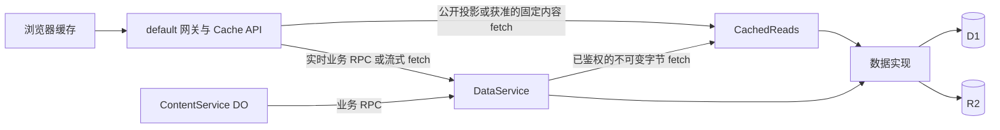

# API 缓存设计与路由清单

本文以仓库实现和 [Worker API 参考](worker-api.md)为基线。`P60` 和 `P300` 分别表示默认 60 秒和 300 秒的公开成功响应；`N` 表示 `private, no-store`。TTL 可配置，设为 0 或非法值禁缓存并对外 no-store，详见[运行配置](runtime-configuration.md)。私有资格、票据和计数始终实时检查。

## 请求路径和边界

Workers Cache 在所有环境停用；使用 Cache API 的缓存按 PoP 独立，`VERSION_METADATA` 用于部署版本隔离，缺失时绕过 Cache API。静态资源可能由 Static Assets 单独交付。具名入口共享 Worker bindings，静态检查是代码约束而非平台权限隔离。

公开投影记录生成时的绝对到期时间，外层只使用剩余期限，缺失、非法或过期则 no-store；内部控制头不返回浏览器。不可变字节按版本或 hash 分区，每次仍需实时门禁。仅公开白名单内的成功结果有资格缓存，错误、部分失败和私有响应不公开缓存。

不使用全球主动 purge 或 epoch；写后各 PoP 的旧数据可能留至到期，在途请求可能在变更后填入旧数据，浏览器缓存及保存的字节也无法收回。TTL 不是全球撤回时限。源端重新执行时检查当前公开资格；实际命中、部署和费用需经授权的 hosted 观测，当前尚未验证，上线仍需用户明确授权。

## 公开发现和下载

除资源表另写完整路径外，路径均以 `/api/v1` 为前缀。缓存资格不证明平台 HIT。

| 方法与路径 | 用途 | 对外默认策略 | 内部缓存与实时门禁 |
| --- | --- | --- | --- |
| GET `/health` | 版本和绑定存在性 | N | 无 |
| GET `/home` | 首页三段聚合 | 全成功 P60；部分失败 N | 公开成功投影 60 秒；部分失败不缓存 |
| GET `/projects`、`/projects/batch` | 列表与批量摘要 | P60 | 公开投影 60 秒；batch 每次最多 50 个 ID |
| GET `/projects/discovery` | 发现 | P60 | 公开投影 60 秒 |
| GET `/projects/:id`、`/projects/:id/entries` | 公开详情及索引 | P60 | 公开投影 60 秒 |
| GET `/projects/:id/preview/:kind` | 登录用户预览 | N | 实时会话和当前公开 revision 门禁后，固定 revision/kind/hash 投影 86400 秒 |
| POST `/projects/:id/downloads`、`/acquisitions` | 票据与版本准入 | N | 不缓存；实时版本与权限 |
| GET `/downloads/:token` | 一次性消费并下载 | N | 固定 hash 字节可复用；每次实时取对象、竞争消费及计数 |
| GET `/recommendations` | 公开推荐 | P60 | 公开投影 60 秒 |
| GET `/reference-sets`、`/reference-sets/:id`、`/site` | 参考集与站点 | P300 | 公开投影 300 秒 |

## 认证、会话与当前用户

这些路径均为 `N / 无`，会话、角色、用户状态与写入实时处理；不使用内部共享缓存。

| 方法与路径 | 用途 | 策略 |
| --- | --- | --- |
| POST `/auth/flows` | 创建 OAuth 流并设置绑定 cookie | 不缓存 |
| GET `/auth/flows/:id` | 查询 OAuth 流状态 | 不缓存，状态及绑定需实时检查 |
| POST `/auth/flows/:id/redeem` | 兑换设备或 embed 授权 | 不缓存，一次性操作 |
| GET `/auth/callback` | OAuth 回调及 HTML 消息 | 不缓存，保护授权码和令牌 |
| DELETE `/sessions/current` | 撤销会话 | 不缓存，实时生效 |
| GET `/me` | 当前用户和角色 | 保持不缓存，避免角色和撤销陈旧 |
| GET `/me/projects` | 作者项目列表 | 保持不缓存；可评估受保护投影，但每次先鉴权 |
| GET `/me/projects/:id/submissions` | 作者投稿历史 | 保持不缓存，需项目权限 |
| GET `/me/subscriptions` | 当前用户订阅 | 保持不缓存 |
| GET `/me/state` | 当前用户对项目的互动状态 | 保持不缓存，避免用户混淆及写后陈旧 |
| PUT、DELETE `/me/likes/:id` | 点赞、取消点赞 | 不缓存 |
| PUT、DELETE `/me/subscriptions/:id` | 订阅、取消订阅 | 不缓存 |
| PUT、DELETE `/me/ratings/:id` | 设置、删除评分 | 不缓存 |

## 作者、审核和管理

以下均为 `N / 无`；草稿、审核和管理读取受身份及项目权限约束，版本竞争控制和写入实时执行。获准后的固定 hash 文件字节可内部复用，不缓存当前关联或权限。

| 方法与路径 | 用途 |
| --- | --- |
| POST `/projects` | 创建项目 |
| GET `/projects/:id/draft` | 获取作者草稿及 rowVersion |
| PATCH、DELETE `/projects/:id` | 更新元数据、软删除项目 |
| PATCH `/projects/:id/visibility` | 修改可见性 |
| POST `/projects/:id/versions` | 创建修订 |
| GET `/projects/:id/gallery` | 获取作者画廊 |
| PUT、DELETE `/projects/:id/gallery/:slot` | 上传或删除画廊图片 |
| GET、PUT `/projects/:id/versions/:versionId/files/:kind` | 读取或上传修订文件 |
| DELETE `/projects/:id/versions/:versionId/entries/:kind/:entryKey` | 删除修订条目 |
| POST `/projects/:id/versions/:versionId/submit` | 提交修订审核 |
| POST `/projects/:id/submissions/:submissionId/withdraw` | 撤回投稿 |
| GET `/admin/submissions` | 待审投稿列表和计数 |
| GET `/admin/submissions/:id` | 投稿详情 |
| GET `/admin/submissions/:id/files/:kind` | 审核文件 |
| GET `/admin/submissions/:id/diff` | 投稿差异 |
| POST `/admin/submissions/:id/recheck` | 重新排队检查 |
| POST `/admin/submissions/:id/review` | 批准或拒绝投稿 |
| GET `/admin/projects` | 管理项目列表 |
| GET `/admin/members` | 成员列表 |
| PUT `/admin/members/:id/role` | owner 修改角色 |
| GET `/admin/audit-events` | 审计事件 |
| PUT、DELETE `/admin/recommendations/:projectId` | owner 设置或删除推荐 |
| POST `/admin/reference-sets` | owner 创建参考集 |
| POST `/admin/reference-sets/:id/versions` | owner 创建参考集版本 |
| PUT `/admin/reference-sets/:id` | owner 更新参考集 |
| POST `/site/banner` | owner 上传 banner |
| PUT `/site` | owner 更新站点 |
| GET `/companion-scripts/:scriptId` | 获取伴随脚本当前版本 |
| GET `/companion-scripts/:scriptId/versions/:version` | 获取指定伴随脚本版本 |
| PUT `/companion-scripts/:scriptId/versions/:version` | owner 注册不可变版本 |

伴随脚本的两个 GET 虽公开，当前不在公开投影缓存白名单中，继续实时读取。

API 的 `OPTIONS` 是 CORS 预检，不属于公开 GET/HEAD 缓存；允许来源返回 204，否则 403。未匹配 `/api/*` 返回 JSON 404，其他未知路径返回文本 404；不将这些兜底响应作为公开投影缓存。

## 客户端和资源

| 方法与路径 | 用途 | 对外默认策略 | 内部缓存与实时门禁 |
| --- | --- | --- | --- |
| GET `/api/v1/client/version`、`/client/compatibility` | 频道展示与兼容性 | 成功 5 秒；错误 no-store | 展示策略不作为 acquisition 的授权依据 |
| GET `/client/stable/index.js`、`/client/staging/index.js` | 可变频道入口脚本 | no-store | 实时版本指针 |
| GET `/client/v/:revision/index.js`、`/client/checker/v/:revision/:file` | 版本化脚本与 checker | 一年 immutable、ETag | 固定版本字节可内部复用 |
| GET `/test-dist/CreativeWorkshop/index.js` | 旧导入兼容地址 | max-age=0、must-revalidate | 按现有重验证策略 |
| GET `/assets/*`、`/` | 静态前端 | 静态交付或 Worker 后备策略 | 不视为 API 投影 |
| GET `/api/v1/public-assets/*` | 公开 cover、gallery、banner | P60 | 实时解析资格；固定字节可内部复用 |
| GET `/api/v1/assets/*` | 公开或私有图片 | N | 实时授权和关联；固定字节可内部复用 |

版本和兼容性接口的成功响应已设置 5 秒缓存；频道发布后短暂显示旧信息与降低读取开销是明确取舍。Tavern 客户端的 compatibility fetch 显式使用 `cache: "no-store"`，不能假定该调用获得浏览器缓存收益；实际命中尚未验证。`acquisitions` 每次仍读取当前权威版本，可能在 5 秒窗口内与显示结果不一致。

## 受保护内容与成本

预览及文件先实时检查会话、角色、项目可见性和当前关联，再以服务器生成的 revision、kind 和 hash 描述符读取内部不可变内容。缓存不包含 token 或当前角色，不得由客户端指定可信 props。隐藏或撤销后服务端不再交付，但无法撤回已交付浏览器的字节。

统计须分别记录外部请求 E、内部 cached fetch I、非缓存 fetch F、RPC R、D1 实际 rows_read/rows_written 和 R2 操作。安装 N 个唯一项目分为 ceil(N/50) 批。没有线上测量不能声称具体 HIT、费用或节省百分比。

Cache API 的机制及限制参见 Cloudflare 官方 [Cache API](https://developers.cloudflare.com/workers/runtime-apis/cache/)；实际命中与费用需在获授权环境验证，源码和响应头不能替代该证据。
